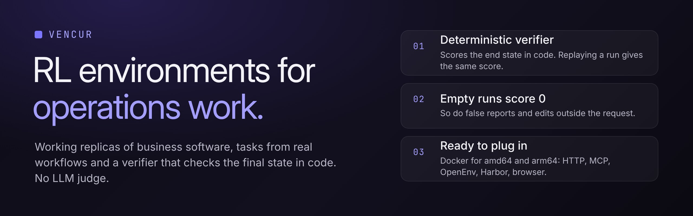

*Replicating real work to train the AI economy.*

**Verified RL environments built on realistic business software.**

We build self-hosted replicas of the software people use at work. Each replica comes with real rules, real paperwork
and colleagues who answer, and we turn it into environments for training and evaluating agents. Computer-use agents
work in the browser GUI. Tool-use agents call the same functions over HTTP or MCP. A deterministic verifier scores the
end state of the software. No language model judges.

## What every environment ships with

- **A sealed scoring image.** The verifier and the reference solutions live in their own image. The agent's container
  never sees them.
- **Proof of quality.** These checks run on every request:
  - the reference solutions pass;
  - empty runs, false reports and edits outside the request score 0;
  - replaying a run gives the same score.
- **Formats.** Docker images for linux/amd64 and linux/arm64, with HTTP, MCP, OpenEnv, Harbor and a browser GUI.

## Environments

| Environment | What the agent does | Public sample |
|---|---|---|
| OpsDesk Workforce | HR and staffing back office of a shift-based employer under German labour law. The agent plans and repairs rotas, handles swaps, sick calls and agency staff, and gets works-council approval. | [opsdesk-workforce-sample](https://github.com/vencur-ai/opsdesk-workforce-sample) |

## Work with us

- Private evaluation sets and custom scopes on your own software stack: [request a pilot](https://getvencur.com).
- Contact: info@getvencur.com
