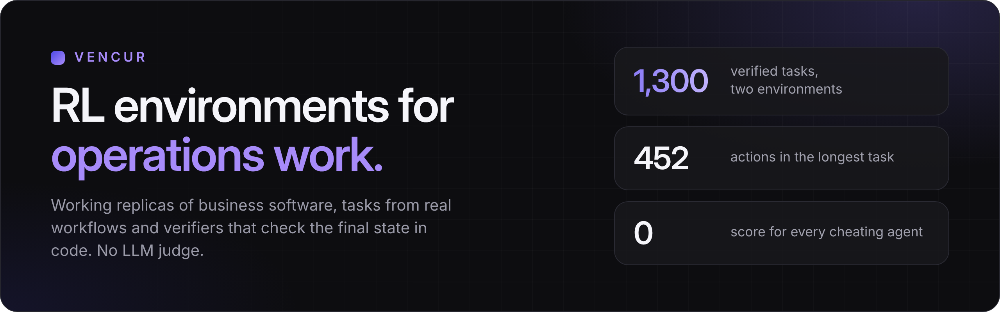

**Vencur builds reinforcement-learning environments for operations work.** Each one is a working replica of the business software an agent uses on the job, filled with tasks from a real workflow and scored by a deterministic verifier that checks the final state in code. No LLM judge.

Computer-use agents work in the browser. Tool-use agents call the same functions over HTTP or MCP. Both change one shared workspace, and the same verifier scores both.

## Environments

| | [OpsDesk Workforce 3.2](https://github.com/vencur-ai/opsdesk-workforce-sample) | [OpsDesk FullCare](https://github.com/vencur-ai/opsdesk-fullcare-sample) |
|---|---|---|
| **The software** | Care-home rota and staffing, with mail, team chat and calendar on one state | Care-home nursing: care record, assessments, GP instructions, transfers and handover, next to rota, mail, chat and calendar |
| **Verified requests** | 1,000 in 10 families, easy to expert | 300 in 14 workflows |
| **Long horizon** | a tier of 36 requests that need 143–452 actions | whole early shifts with handover |
| **Rules** | UK and German working-time law, works council, house rules | 71 care standards, German and UK editions |
| **Hard gates** (any fail scores 0) | a broken working-time or house rule, a shift left open that could be covered, a false statement in the app, medical details in a group channel | a changed medication plan or doctor's order, a diagnosis, an invented value, health data shared with someone not allowed to see it |
| **Public sample** | 5 tasks with references, proof report and demo | 5 tasks incl. a 145-step early shift, proof report and demo |

Also public: the [OpsDesk API edition](https://github.com/vencur-ai/opsdesk-care-sample), the same staffing workflows for tool-use agents only, with rosters of up to a month.

Every sample runs locally in minutes and ships the verifier with its own reference solutions, so you can score your own agent before you talk to us.

## How frontier models do

| Environment | Run | Claude Opus 5.5 |
|---|---|---|
| Workforce 3.2 | first 7 of 20 pre-registered requests, one attempt each | 3 of 7 fully solved |
| FullCare | 14 requests, two attempts each | 17 of 28 attempts solved |
| API edition, hard and expert tier | blind run, one attempt each | 0 of 13 fully solved, mean score 0.86 |

Where it fails: shifts left open although a qualified person was free, swap requests mishandled, colleagues not told about a changed shift, rotas a few percent dearer than needed, follow-up work skipped (a pressure-relief mattress, the pharmacy not told about a changed medication) and hospital-transfer sheets left incomplete. Scores are dense, with hard gates first and weighted layers after, and `passed` is the strict binary reward. A run with several models follows in November 2026.

## Proven against reward hacking before release

| | Workforce 3.2 | FullCare |
|---|---|---|
| Cheating agents | 7 kinds score 0 on every request | 6 kinds score 0 on every request |
| Near misses (one thing wrong) | none of 616 reaches 0.995 | none of 6,449 passes |
| Equivalent solutions by another route | all 636 score 1.0 | all 1,003 score 1.0 |

Workforce references come from a CP-SAT solver (278 of the 301 evaluation references are proven optimal), and runs through the GUI and through the API reach the same state in 301 of 301. Every sample ships the proof report for its own tasks, with every cheating agent and every near miss, so you can check all of this yourself. If you find a way to game one, write to us.

## Built with practitioners

Care standards and staffing rules were set or confirmed by a practising head of nursing in long-term residential care (35 years in nursing, 17 as head of nursing). All homes, residents, staff and records are fictional.

## Formats

Docker (offline) · Harbor · HUD (computer use and MCP) · OpenEnv · verifiers · HTTP · MCP

## Work with us

- **Evaluation sets:** fresh requests from new seed blocks that never appear in a public sample. The references stay with us, and your exported workspaces are scored by the same verifier.
- **Training sets:** references sealed into a scoring image, so the score works as a reward. Exclusive on request.
- **An environment for your workflow:** a written spec and a fixed price within 24 hours. FullCare went from written spec to 300 verified requests in 3 days.

**[getvencur.com](https://getvencur.com)** · **[info@getvencur.com](mailto:info@getvencur.com)** · South Tyrol, Italy
